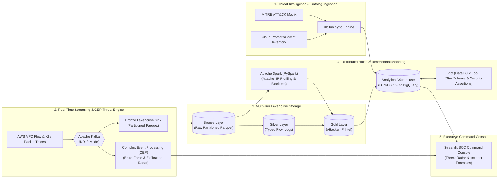

# CyberPulse — Real-Time Cloud SIEM & Threat Intelligence Lakehouse

[](https://python.org)
[](https://www.docker.com/)
[](https://kafka.apache.org/)
[](https://spark.apache.org/)
[](https://www.getdbt.com/)
[](https://kestra.io/)
[](https://github.com/Ghaberitsohaib/cyberpulse-data-platform/actions/workflows/ci.yml)

> **CyberPulse** is an enterprise-grade Security Information and Event Management (SIEM) Data Platform designed for cloud-native infrastructure defense. It ingests high-frequency VPC flow logs, Kubernetes network packet traces, and authentication attempts via Apache Kafka, runs sliding-window **Complex Event Processing (CEP)** against the **MITRE ATT&CK** matrix, lands partitioned forensic logs in a multi-tier Parquet lakehouse, and drives automated attacker profiling using Apache Spark and dbt.

---

## Architecture Diagram



---

## Key Cybersecurity Data Engineering Concepts Implemented

| Domain Concept | Implementation in CyberPulse |
| :--- | :--- |
| **Complex Event Processing (CEP)** | Inspects streaming network packets in sliding windows to flag SSH/RDP brute-force credential spraying, multi-port discovery sweeps, and exfiltration bursts. |
| **MITRE ATT&CK Classification** | Automatically maps raw firewall drop/allow events to standardized attack tactics (`T1110.001` Password Spraying, `T1046` Port Scan, `T1048.003` Exfiltration). |
| **Protected Asset Exposure Matrix** | Correlates destination IPs against critical production infrastructure (Kubernetes clusters, Postgres primaries, Bastion hosts). |
| **Distributed Attacker Profiling** | PySpark batch job calculating block rate ratios, attacked port diversity, and peak threat scores per external entity. |
| **Forensic Audit Data Quality** | Automated **dbt assertions** verifying positive packet counts, timestamp integrity, and IP address format validations. |
| **Infrastructure as Code (IaC)** | Modular **Terraform** provisioning GCP Cloud Storage buckets and partitioned BigQuery datasets for multi-year compliance. |

---

## Repository Structure

```
cyberpulse-data-platform/
├── docker-compose.yml              # Cluster: Kafka, MinIO, Spark, Kestra, Dashboard
├── requirements.txt                # Python libraries
├── terraform/                      # Terraform GCP BigQuery & GCS Buckets
├── ingestion/                      # dltHub pipelines for MITRE Matrix & Asset Catalog
├── streaming/                      # Kafka security producer, CEP threat detector, lakehouse sink
├── batch/                          # PySpark attacker profiling & blocklist generation
├── analytics_dbt/                  # dbt models (stg_*, fct_*) & automated tests
├── orchestration/flows/            # Kestra declarative workflow DAGs
├── data_platform/                  # Streamlit Executive SOC Command Console
├── scripts/                        # Automated pipeline execution scripts
└── tests/                          # Automated pytest suite
```

---

## Quickstart: Running in 30 Seconds

### 1. Install dependencies:
```bash
pip install -r requirements.txt
```

### 2. Execute the entire pipeline locally:
```bash
python scripts/run_pipeline.py
```

### 3. Launch the SOC Command Console:
```bash
streamlit run data_platform/dashboard.py
```
Open **`http://localhost:8501`** to inspect the real-time threat radar, review attacker IP profiles, and drill down into packet-level forensic traces.

---

## Full Docker Multi-Container Cluster

```bash
docker compose up -d
```
- **SOC Command Console**: `http://localhost:8503`
- **Kafka Stream Monitor**: `http://localhost:9092`
- **MinIO Lakehouse Console**: `http://localhost:9001`
